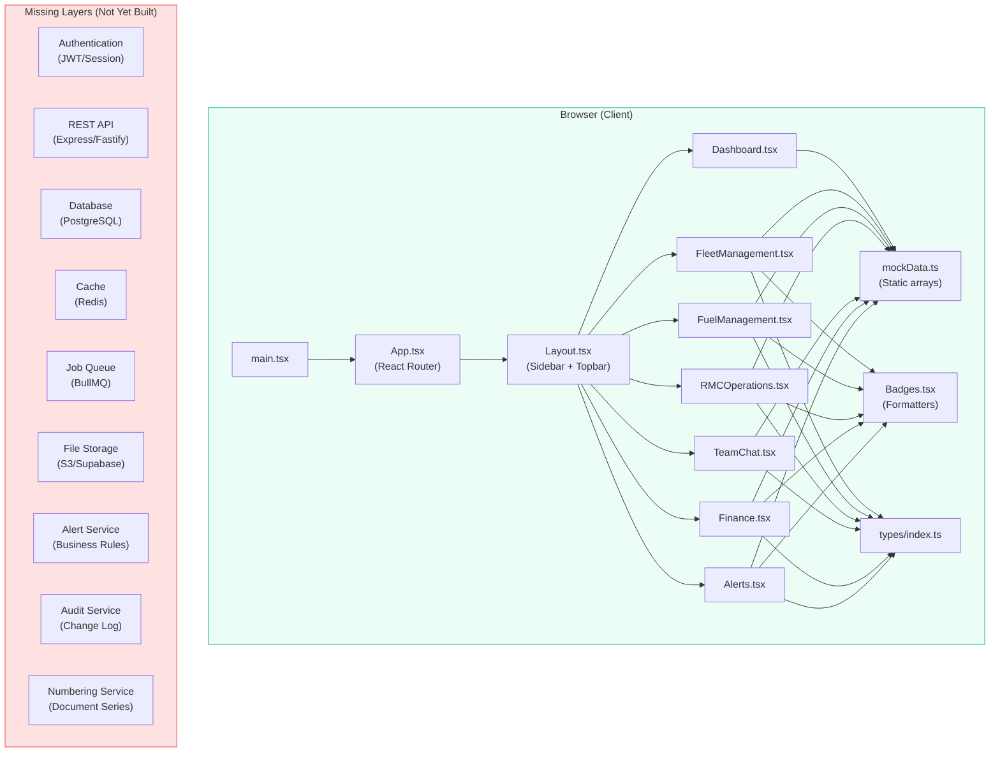

# ConstructERP — Architecture

## 1. Stack Inventory

### Runtime & Languages
| Layer | Technology | Version | Notes |
|-------|-----------|---------|-------|
| Language | TypeScript | 5.7.0 | Strict mode enabled |
| Runtime | Node.js (build only) | ≥18 | For Vite build tooling |
| Frontend Framework | React | 18.2.0 | SPA, client-side rendering |
| Build Tool | Vite | 6.3.5 | Dev server + production build |
| CSS Framework | Tailwind CSS | 4.1.7 | Via `@tailwindcss/vite` plugin |
| Routing | React Router | 6.8.0 | Client-side SPA routing |
| Charts | Recharts | 2.10.0 | SVG-based React charting |
| Icons | Lucide React | 0.294.0 | Tree-shakeable icon library |
| Animation | Framer Motion | 11.16.1 | UI transitions |
| Drag & Drop | @dnd-kit/core | 6.1.0 | Drag-and-drop interactions |
| Date Utilities | date-fns | 2.30.0 | Date formatting/manipulation |
| UUID | uuid | 9.0.1 | Unique ID generation |
| BaaS Client | @supabase/supabase-js | 2.98.0 | **Installed but not used in source code** |

### Package Manager
- **npm** (package-lock.json present)
- No monorepo tooling (no workspaces, no pnpm, no yarn)

### Database Engine
- **None.** No database configured. All data resides in `src/data/mockData.ts` as TypeScript arrays.
- Supabase JS client is installed (`package.json` line 14) but no source file imports or uses it.
- No migration tool (Prisma, Drizzle, Knex, TypeORM, etc.) present.

### Cache
- **None.** No Redis, Memcached, or in-memory cache layer.

### Queue / Job Runner
- **None.** No Bull, BullMQ, RabbitMQ, or background job system.

### File Storage
- **None.** No S3, Supabase Storage, or local file upload handling.

### Search
- **None.** No Elasticsearch, Meilisearch, or full-text search engine.

### Frontend Framework Details
- **React 18.2** with functional components and hooks only
- No state management library (Redux, Zustand, Jotai, etc.)
- No server-state library (React Query, SWR, etc.)
- No form library (React Hook Form, Formik, etc.)
- No component library (shadcn/ui, MUI, Ant Design, etc.)

### Mobile / PWA Capability
- **None.** No `manifest.json`, no service worker, no PWA configuration.
- Responsive CSS via Tailwind breakpoints (sm, md, lg, xl).

### CI/CD
- **None.** No `.github/workflows`, no GitLab CI, no Jenkins, no Dockerfile.

### Hosting & Environments
- **None configured.** Build output is `dist/` (static HTML/CSS/JS).
- No environment files (`.env`, `.env.local`, etc.).
- Vite dev server configured on port 3000 (`vite.config.js`).

### Testing Infrastructure
- **None.** No test runner (Vitest, Jest, Cypress, Playwright) in project dependencies.
- No test files exist in `src/`.
- No linting configuration (no `.eslintrc`, no `eslint.config.js`).
- The only quality gate is `npm run build` (Vite compilation + TypeScript type-checking via `tsc --noEmit`).

---

## 2. Module Map

### Existing Modules (Frontend Only)

| Module | Entry Point | Main Tables/Types | Services | API Routes | UI Entry |
|--------|-------------|-------------------|----------|------------|----------|
| **Dashboard** | `src/pages/Dashboard.tsx` | DashboardKPI | None (static data) | None | `/` |
| **Fleet & Equipment** | `src/pages/FleetManagement.tsx` | Equipment, OperatorLog | None | None | `/fleet` |
| **Fuel Management** | `src/pages/FuelManagement.tsx` | FuelRecord | None | None | `/fuel` |
| **RMC Operations** | `src/pages/RMCOperations.tsx` | RMCOrder, MixDesign | None | None | `/rmc` |
| **Team Chat** | `src/pages/TeamChat.tsx` | ChatChannel, ChatMessage | None | None | `/chat` |
| **Finance & Costing** | `src/pages/Finance.tsx` | FinanceEntry | None | None | `/finance` |
| **Alerts** | `src/pages/Alerts.tsx` | Alert | None | None | `/alerts` |

### Shared Infrastructure

| Component | Path | Purpose |
|-----------|------|---------|
| Layout (sidebar + topbar) | `src/components/Layout.tsx` | App shell, navigation, profile dropdown |
| StatusBadge | `src/components/Badges.tsx` | Renders Status enum as colored pill |
| SeverityBadge | `src/components/Badges.tsx` | Renders Severity enum as colored pill |
| EquipmentStatusBadge | `src/components/Badges.tsx` | Renders equipment operational status |
| formatINR | `src/components/Badges.tsx` | Indian-locale currency formatter |
| formatNumber | `src/components/Badges.tsx` | Indian-locale number formatter |
| formatDate / formatDateTime | `src/components/Badges.tsx` | Date formatters (Asia/Kolkata) |
| Mock Data Store | `src/data/mockData.ts` | 8 equipment, 5 operator logs, 5 fuel records, 4 RMC orders, 4 mix designs, 5 channels, 7 messages, 6 alerts, 5 finance entries |
| Type Definitions | `src/types/index.ts` | 10 interfaces + 3 type unions |

### Modules NOT Present
- Projects / Sites management
- Accounting (chart of accounts, ledger)
- Inventory / Store management
- Procurement / Purchase Orders
- HR / Payroll / Employee management
- Document management
- Notification service (email, SMS, push)
- Vendor management
- Customer management
- Authentication / Authorization
- Audit logging service
- Numbering series service
- Alert service (alerts are displayed but not generated by business rules)

---

## 3. Component Diagram



---

## 4. Data Model Principles

1. Every record carries a `status` field (draft → submitted → pending_approval → approved/rejected)
2. Every reading records its `dataSource` (manual, imported, integrated_live, etc.)
3. All monetary values in INR with Indian digit grouping
4. All timestamps stored/displayed in Asia/Kolkata
5. All quantities in SI units with explicit unit codes

---

## 5. Integration Status

| Integration | Status | Notes |
|-------------|--------|-------|
| GPS Tracking | ⚠️ Unavailable | Interface placeholder in RMC dispatch tab |
| Fuel Meters (IoT) | ⚠️ Unavailable | Manual entry with variance calculation |
| Weighbridge | ⚠️ Unavailable | Not yet implemented |
| GST Portal | ⚠️ Unavailable | Not yet implemented |
| Bank Integration | ⚠️ Unavailable | Not yet implemented |
| Email/SMS | ❌ Absent | No notification service |
| Push Notifications | ❌ Absent | No service worker or push config |
| Maps | ❌ Absent | No map integration |
| PLC/SCADA | ❌ Absent | No industrial protocol interface |
| Payment Gateway | ❌ Absent | No payment integration |

---

## 6. Build & Quality Baseline

| Check | Command | Result |
|-------|---------|--------|
| TypeScript type-check | `npm run typecheck` (`tsc --noEmit`) | ✅ PASS |
| Production build | `npm run build` (`vite build`) | ✅ PASS (9.65s) |
| Linting | N/A | ❌ No linter configured |
| Unit tests | N/A | ❌ No test runner configured |
| E2E tests | N/A | ❌ No E2E framework configured |
| Coverage | N/A | ❌ Not measurable |

### Build Output
```
dist/index.html                   0.82 kB │ gzip:  0.47 kB
dist/assets/index-DVr6Uelk.css   26.25 kB │ gzip:  5.81 kB
dist/assets/index-C5FBJ7uu.js   679.12 kB │ gzip: 185.81 kB
```
⚠️ Single JS chunk exceeds 500 kB warning threshold. Code splitting recommended.
